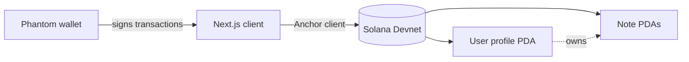

<div align="center">

# 📌 Solana Notes

**A pinboard for your thoughts, stored on-chain.**
Connect Phantom, sign once, and every note lives in its own account on Solana Devnet. Only your wallet can change it.

[](https://YOUR-APP.vercel.app)
[](https://explorer.solana.com/?cluster=devnet)
[](https://nextjs.org)
[](https://www.typescriptlang.org)


</div>

---

## Why this exists

Most notes apps keep your data on someone else's server. Solana Notes flips that: your profile and every note are **accounts on a blockchain**, addressed by your wallet. No sign-up form, no password, no database to leak. Your wallet is your login, and every change is a transaction you approve.

It is also a compact, end-to-end example of a real Solana dApp: an Anchor program on the back end and a typed Next.js client on the front end.

## Features

| | |
|---|---|
| 🔐 **Wallet login** | Connect with Phantom. No email, no password. |
| 👤 **On-chain profile** | Pick a username once. It is saved in a program-derived account (PDA) tied to your wallet. |
| 📝 **Create notes** | Title (up to 100 characters) and content (up to 500), each saved as its own on-chain account. |
| ✏️ **Edit and delete** | Update or remove any of your notes. Every change is signed by your wallet. |
| 🧾 **Transparent** | Each note shows its PDA address, so you can look it up on Solana Explorer. |
| 🎨 **Pearl and graphite UI** | A light pinboard theme with gradients, sticky notes that drop in on load, and tactile buttons. |
| 📱 **Responsive** | Works on desktop and in the Phantom mobile browser. Respects reduced-motion settings. |

## Try it in 2 minutes

You need the Phantom wallet and a little free **Devnet** SOL (test money, not real).

1. **Install Phantom** from [phantom.com](https://phantom.com).
2. In Phantom, open **Settings → Developer Settings**, turn on **Testnet Mode**, and select **Solana Devnet**.
3. Copy your Solana address and get free test SOL at [faucet.solana.com](https://faucet.solana.com) (choose **Devnet**).
4. Open the [live app](https://solana-notes-murex.vercel.app/), click **Select Wallet**, choose **Phantom**, and approve.
5. Pick a username, then start pinning notes.

> **On mobile?** Open the link inside the Phantom app's built-in **Browser** tab. Regular mobile browsers cannot connect to the wallet.

> **Heads up:** blockchain data is public. Anyone can read your notes on Solana Explorer, even though only you can edit them. Do not store passwords or private information.

## How it works



- The **profile** is a PDA derived from your wallet address. If it does not exist yet, the app shows the create-profile step.
- Each **note** is a separate PDA account. The dashboard fetches your notes and renders them as sticky notes.
- Creating, editing, and deleting notes are Anchor instructions. The wallet signs, the program validates, the chain stores.

## Tech stack

| Layer | Tools |
|---|---|
| Framework | Next.js 14 (App Router), React, TypeScript |
| Blockchain | Solana Devnet, Anchor (`@coral-xyz/anchor`), `@solana/web3.js` |
| Wallet | `@solana/wallet-adapter` (react and react-ui), Phantom via Wallet Standard |
| Styling | Tailwind CSS plus a custom CSS theme (`ink.css`), Bricolage Grotesque and Figtree fonts |
| UX | `react-hot-toast` for transaction feedback |
| Hosting | Vercel |

## Project structure

```
src/
├── app/
│   ├── layout.tsx          # fonts + wallet provider
│   ├── page.tsx            # loads the dashboard client-side
│   ├── globals.css
│   └── ink.css             # pearl + graphite theme
├── components/
│   ├── WalletProvider.tsx  # connection + wallet adapter setup
│   ├── Dashboard.tsx       # main screen and data fetching
│   ├── CreateUser.tsx
│   ├── CreateNote.tsx
│   ├── NoteList.tsx
│   └── NoteCard.tsx
├── hooks/
│   └── useNoteProgram.ts   # Anchor program client (profile + notes)
├── types/                  # shared TypeScript types
└── utils/
    └── constants.ts        # network / RPC config
```

## Run it locally

**Prerequisites:** Node.js 18+, the Phantom extension, and Devnet SOL.

```bash
# 1. Clone
git clone https://github.com/Anish2804/solana-notes.git
cd solana-notes

# 2. Install
npm install

# 3. Start the dev server
npm run dev
```

Open [http://localhost:3000](http://localhost:3000).

### Optional: use your own RPC

The public Devnet endpoint is rate-limited. For a faster experience, get a free Devnet key from a provider such as Helius or QuickNode and create `.env.local`:

```bash
NEXT_PUBLIC_RPC_URL=https://your-devnet-rpc-url
```

Then in `src/utils/constants.ts`:

```ts
import { clusterApiUrl } from "@solana/web3.js";

export const NETWORK =
  process.env.NEXT_PUBLIC_RPC_URL ?? clusterApiUrl("devnet");
```

## Deploy your own

1. Push the repo to GitHub.
2. Import it on [Vercel](https://vercel.com). The Next.js preset works out of the box.
3. Add `NEXT_PUBLIC_RPC_URL` under **Environment Variables** if you use a custom RPC, then deploy.

## On-chain program

| | |
|---|---|
| Network | Solana Devnet |
| Program ID | `6LwYsQzk9eaRQNPeWfXLYaJTEKcTJ1SPMr77paPdrgGQ` |
| Explorer | [View on Solana Explorer](https://explorer.solana.com/address/6LwYsQzk9eaRQNPeWfXLYaJTEKcTJ1SPMr77paPdrgGQ?cluster=devnet) |

## Roadmap

- [ ] Search and filter notes
- [ ] Color tags for notes
- [ ] Optional client-side encryption so note content is private on-chain
- [ ] Mainnet-ready build with a configurable cluster
- [ ] Unit and integration tests for the client hooks

## What I learned

- Modeling app data as **PDAs** instead of database rows, and how that shapes the client's fetch logic.
- Wiring **Wallet Standard** wallets with the Solana wallet adapter and handling connection edge cases such as duplicate connect requests under React Strict Mode.
- Making a dApp feel responsive on a rate-limited public RPC.

## Contributing

Issues and pull requests are welcome. For larger changes, please open an issue first to discuss what you would like to change.

## License

Released under the [MIT License](./LICENSE).

---

<div align="center">

Built by [YOUR NAME](https://github.com/Anish2804) · If this helped you, a ⭐ on the repo means a lot.

</div>